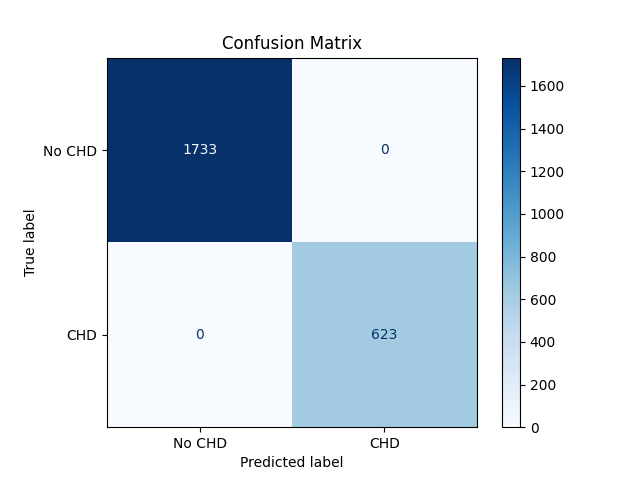

# Prenatal Congenital Heart Defect Detection with Deep Learning

Congenital heart defects (CHDs) are the most common type of birth defect, and many are missed on prenatal ultrasound. This project trains a convolutional neural network to flag CHDs, and specifically ventricular septal defects (VSDs), from echocardiogram frames. A prototype assistant then turns each prediction into guideline-based follow-up steps for clinicians.

## Data
- **[EchoNet-Pediatric](https://stanfordaimi.azurewebsites.net/datasets/a84b6be6-0d33-41f9-8996-86e5df53b005)** (Stanford AIMI): pediatric echocardiogram videos
- **Fetal Heart Academy**: prenatal echocardiogram videos

Raw videos are not included in this repository. Download them from the sources above.

## Pipeline
| Step | Script |
|---|---|
| Extract frames from echocardiogram videos | `extracting.py` |
| Convert frames to normalized grayscale | `Grayscale.py` |
| Label frames (CHD vs. Non-CHD; CHD vs. Non-CHD vs. VSD) | `Labeling.py` → `labeled_frames.csv`, `labeled_frames_VSD.csv` |
| Model 1: CHD vs. Non-CHD (DenseNet-264) | `Training5.py` |
| Model 2: VSD vs. Non-CHD (DenseNet-264) | `TrainingFinal.py` |
| Run the model on new echocardiograms | `Testing.py` |
| Plot the confusion matrix | `Confusion_Matrix.py` |

## Results
CHD vs. Non-CHD classification on a held-out set of 2,356 frames (1,733 Non-CHD, 623 CHD):

More confusion matrices are in [`Graphs/`](Graphs/).

**Caveat:** the train/test split is done by frame, so frames from the same video can appear in both sets. This likely overstates accuracy on new patients. Re-evaluating with a video-level split is the next step.

## Limitations and next steps
- Split train/test data by video instead of by frame, and report video-level accuracy.
- Small dataset from two public sources; results need validation on larger, independent data.
- Extend classification to other defects (ASD, coarctation of the aorta).
- Evaluate the clinician assistant with cardiologists.

## Author
Atharv Kapoor
